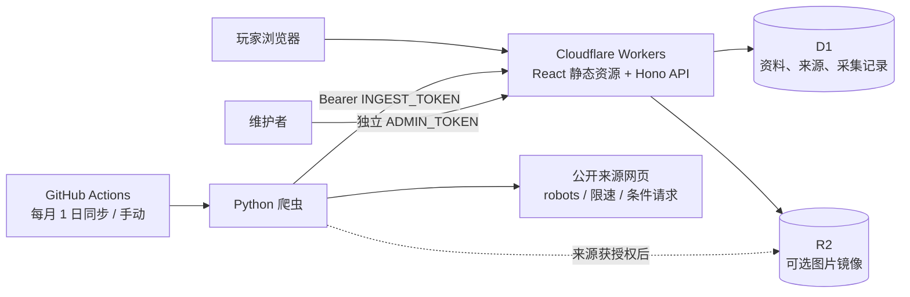

# 阵研所架构

状态：第一版可运行基础；家乡村庄优先，建筑大师基地预留。2026-10-12。

## 技术选择与边界

Python 跑在 GitHub Actions 或自己的定时任务环境，线上请求跑在 Workers。两者通过 HTTP 数据合同解耦，不把解析、网络重试、图片下载放入用户访问链路。网站不需要常驻 Python 服务器。Cloudflare 虽有 Python Workers，但爬虫的依赖、较长运行和调试需求更适合独立运行环境。

选择一个仓库、一个 Worker、一个 D1、一个 R2；暂不引入微服务、Redis、独立搜索引擎和任务队列。需要用户账号时再接身份提供方；当前收藏保存在浏览器，不会伪装成云同步。Cloudflare 自有账户部署为交付目标，不依赖 Sites 托管账户。

## 目录和职责

| 目录 | 职责 |
|---|---|
| `web/` | React 展示、筛选、分页、原图、配兵图标、游戏跳转、收藏 |
| `worker/` | Hono 路由、鉴权、查询、入库、来源开关、人工状态维护、R2 读取 |
| `shared/schema.ts` | TypeScript/Zod 入库合同、共享类型 |
| `crawler/atlas/` | HTTP 客户端、适配器、标准化、发布、可选图片镜像 |
| `crawler/sources.toml` | 可替换来源、域名白名单、等级、限速和图片策略 |
| `migrations/` | 顺序执行的 D1 SQL 迁移 |
| `.github/workflows/` | 检查、采集、手动部署 |

## 数据模型

`entries` 用 kind 区分 base/army，用 village 区分 home/builder；大本营等级是数据字段，不是代码枚举。`hall_levels` 管理可选等级，新增大本营通过迁移加行，无须修改前端。配兵单位保留 name/count/group/image_url，按兵种、法术、攻城机器、英雄分组。原文攻略暂不整篇转载。

配兵新增 `hero_loadouts`，每项保留英雄、对应宠物、最多两件装备、原文备注、搭配原始页面和短证据文字。`pet=null` 或装备槽空缺表示来源未注明，不能解释为该英雄不带宠物/装备，也不能跨攻略拼凑。配图单独保留 `image_source_url`，图鉴提供插图不代表图鉴推荐这套搭配。通过 `0002_hero_loadouts.sql` 添加 JSON 字段，旧记录默认空数组，前端仍能从旧英雄单位显示未知配置。内容哈希包含搭配，修改宠物或装备会更新内容时间，人工状态保持。

详情先展示英雄搭配；手机单列、平板双列，每个英雄的宠物和两件装备固定在同一卡片。缺图但有明确名称的装备保留文字；原文备注不是装备。没有完整可数单位表的攻略保留来源配兵截图，不从零散文字猜测兵种数量。游戏分享载荷原样保存，尚未建立 ID 字典的英雄/宠物/装备编码不猜测解码。

来源用 `sources` 管理，每个源独立启停。`provenance` 保留同一分享链接的多个来源，避免重复收录丢失出处。`crawl_runs` 保存成功、部分失败、完全失败、发现量和入库量；公开 API 隐去内部错误详情，维护者可读取完整记录。

列表卡片明确标出可点击的来源名称和最近采集时间；详情的“采集出处”展示全部原始页面 URL、每个页面的首次/最近采集时间（北京时间）和当前内容来源。列表与详情 API 均返回 `origins`，分页使用一次批量查询读取出处，避免逐条查询。来源总览按出处关联统计资料数，同一条内容可同时计入多个来源。多个出处仅表示曾被收录于这些页面，不标为独立验证或官方认证；原网页可能已变化，当前未保存历史页面快照。

有分享链接的 ID 是 `SHA256(kind:village:town_hall:游戏载荷)`，不依赖分享语言、query 顺序、utm 参数。同一配兵适用于不同大本营时分别保留等级条目，避免按链接去重导致某个等级失去资料。没有分享链接的阵型使用来源 URL 作为身份，只提供图片参考；页面明确禁用复制按钮。链接不存在与链接未验证是两种状态。

`created_at` 表示本站首次入库，`updated_at` 表示本站检测到标题、用途、标签、图像或配兵内容变化，`last_seen_at` 表示最近一次采集。三者都不是原作者发布日期。图像 URL 不变但原站覆盖图片时，仅引用模式无法判断图像内容变化；镜像模式可由内容哈希识别。

重复入库是幂等 upsert，每个批次在 D1 batch 事务内写入；内容哈希没变不刷新 updated_at。人工 hidden/expired/confirmed 状态不被采集覆盖。来源消失不自动删除历史条目，需复核后下架，防止短暂故障清空资料库。

## 采集策略

当前 5 个来源适配器：Clash of Clans Layouts 中文阵型列表/详情、Clashcodes 中文单套与合集阵型、ClashBaseLink 按等级整理的阵型集合、Clashest 公开配兵列表，以及 Blueprint CoC 的明确配置攻略页面。新增两站均先从来源导航发现实际等级 URL，不猜测未提供的分类地址。Clashcodes 按图片自身的官方分享链接匹配合集条目；单套模板仅允许正文内唯一图片与唯一复制按钮配对。ClashBaseLink 限定正文图片卡片与随后复制按钮一对一匹配，用过的图片不会复用。Clashest 从英雄所在列表项提取装备，角色分工（如 funnel/cleanup）保留为备注。Blueprint 只解析配兵段落和明确的英雄宠物句子，限定在该攻略内。Blueprint 目前仅配置一篇 TH18 Hydra 种子攻略，每轮刷新该页，不宣称自动发现其全部新文章；新增攻略须加入 `sources.toml` 的 pages。图鉴配图登记在 `crawler/atlas/assets.json`，名称和地址均来自实际图鉴页面；新增名称若尚无已核对图片则显示文字，维护者可补充图鉴登记。阵型采集原图和官方 OpenLayout 链接；配兵采集官方 CopyArmy 链接以及可数的单位图片和数量。实际来源覆盖范围：阵型 TH3–18；当前配兵来源 TH8–18。TH1/2 暂无来源，界面保留入口和明确空态。支持等级不等于已填满所有等级。

默认 `sync` 按月同步，每月 1 日北京时间 08:17 运行。不限制每来源每级条数或历史列表页数，只有可优雅退出的执行时间预算；手动试采仍可显式传 `--limit` / `--max-pages`，0 或省略表示无限。各来源独立 Actions job，互不挤占时间预算；同一来源的并发运行串行化。前端每页 12 条仅是显示分页。

历史游标保存下一列表页、待处理文章、已访问页，以及文章内已经处理的分享 ID。未完成时直接从历史位置继续；只有整个该等级遍历完成后，下一次 `sync` 才重新扫描列表以发现新增条目。`backfill` 只续历史，完成后不会重开；`incremental` 是手动刷新元数据的模式，不用于定时任务。已收录且有分享链接的独立 Layouts 详情跳过请求，无链接条目仍检查是否补回链接。合集页面仍读取以发现追加链接；相同观察且内容不变时跳过，配置文字变化时更新原条目。按同一本游戏载荷去重，忽略语言、query 顺序和跟踪参数；跨本适用的同一配兵按用户要求保留各本入口。

每处理一个列表页或详情就检查点保存，按分享 ID 恢复，不按行号跳过。只跟随同域、同等级、连续的实际分页链接，循环或断页报错；403/429/robots 拒绝时停止该来源，失败文章保留重试。来源暂不可达不删除已有资料。时间预算到达时正常退出并保留待处理项。

本地快照按“分享身份＋来源 ID＋原始页面”保留观察记录，D1 按分享身份保留一条并关联全部出处。先原子保存快照，再发布并写成功投递的内容哈希，最后提交游标。发布失败不推进该详情断点；启动时先重放未收到成功响应的数据，避免快照去重误把未发布内容跳过。不同 API 目标各自重新初始化投递记录，不能把本地存在当成远端已入库。成功确认的相同内容不会重复投递；响应丢失时允许安全重放，D1 幂等 upsert 兜底。

Actions 每来源分别缓存 HTTP 和快照。每次运行另上传 90 天的快照、投递记录和游标附件，下次先从最近附件恢复，避免缓存跨月被清理而丢失历史位置；解析或发布部分失败也保留附件。附件恢复异常会让任务失败，不能静默当作首次运行。若缓存与附件都已失效，会重新遍历并由 D1 去重，不会删除线上资料；长时间停用前应另行备份状态。当前并未宣称全站历史已采完。最新含义是采集时来源可见内容，不能保证覆盖整个互联网或游戏最新强势玩法。

HTTP 客户端检查 robots.txt，404 时按无 robots 处理，403/429/其他失败时暂停；每个域名默认至少间隔 2 秒，尊重更大的 Crawl-delay。只访问配置的 HTTPS 域名，校验重定向目标；5xx/临时网络故障最多重试 3 次，403/429 不继续重试或绕过。HTML 限制 5 MB，镜像图像限制 8 MB。SQLite 缓存 ETag/Last-Modified 和原响应，304 时仍能解析缓存内容。解析选择器失效要报错，不能静默视为成功。

远端入库是 25 条/批，线上 Zod 再校验一次。Python 与 TypeScript 的校验有重合但服务端是最终边界；双方测试包含载荷身份一致的案例。发布失败后可重跑；部分成功不回滚已入库内容，也不删除旧内容。GitHub Actions 非成功运行退出为失败，便于通知维护者。

robots 允许访问不代表图片可再分发。默认仅保存原始图片地址及来源；来源授权明确后，将该来源 mirror_images 设为 true，采集端通过 S3 API 上传 R2，以图片内容哈希为 key，Worker 提供不可变图片缓存。兵种图片与阵型原图使用相同管线。开启镜像前需确认来源自身条款和图片使用条件。

游戏链接只校验域名、action、载荷和阵型等级。HTTP 200 不能证明游戏内可用，因此新链接一律 unverified；只有人工游戏内导入后才能 confirmed，用户反馈待复核用 reported，确认失效用 expired。链接可能受游戏区服与客户端影响，当前接入的是国际版分享域名；国服来源与导入协议需另接适配器。

## 访问、缓存与运维

前端静态资源由 Workers Assets 分发；仅 `/api/*`、`/media/*` 进入 API Worker。API 公开只读 GET、参数化 SQL、分页最大 48 条。首页等级统计先对资料做一次聚合，再关联等级表，避免逐等级扫描整批资料；最近采集时间保留单独查询，以维持原有语义。当前使用 LIKE 搜索，适合初期规模；数据量和查询指标证明需要时再升级 D1 FTS5。API 不把任意 URL 当图片代理，不在浏览请求中抓取第三方站点。

公开查询使用 Cloudflare Cache API 的 `atlas-public-v1` 缓存：`/api/catalog` 与 `/api/sources` 共享缓存 300 秒，列表、详情与批量详情共享缓存 60 秒。命中时直接返回响应，不访问 D1；`X-Atlas-Cache: HIT/MISS` 用于验证。列表键规范化默认参数、筛选和分页，忽略参数顺序与无关跟踪字段。错误、健康检查、入库与管理响应不进入共享缓存。浏览器缓存最多 60 秒，并按共享缓存剩余时间缩短，防止旧响应继续延长缓存。Cache API 失败时回退到 D1。

成功入库、运行记录更新及管理操作会更换当前数据中心的缓存版本，使该节点的列表、详情、批量详情和汇总同时失效；不需要逐一枚举筛选组合，也不新增 D1/KV 版本读取。Cache API 不跨数据中心复制，其他节点依靠 TTL 更新：内容最多延迟 60 秒，数量与来源汇总最多 300 秒。缓存命中仍计入 Worker 请求，冷缓存并发请求仍可能分别查询 D1；这不是全局缓存或用量硬上限。

收藏通过 `/api/entries/batch?ids=...` 每批最多 80 个 SHA256 ID 读取，避免超出 D1 单条语句 100 个参数的限制；200 条收藏最多 3 个 HTTP 请求、6 条 SQL。隐藏、过期和不存在的资料不返回，保留完整出处，去重并规范化缓存键。前端优先复用已加载列表资料，以 60 秒会话缓存合并缺失条目的在途请求；只在进入收藏、收藏集合变化或手动重试时加载。收藏页翻页、搜索、等级/用途筛选与排序均基于已加载快照进行，不再发请求。离开再进入时检查缓存鲜度；不会将资料详情持久化到 localStorage。

入库和管理令牌分开，Worker secrets 存储，前端不含令牌；未配置令牌时写入接口拒绝服务。入库大小限制 512 KB，包括分块请求。R2 只接受经过文件头与 MIME 检查的 PNG/JPEG/WebP，不接受 SVG/HTML。管理接口当前是机器 API，部署时可在它前面增加 Cloudflare Access；第一版没有公开后台登录界面。

日志在 Workers Observability 和 Actions 中查看；采集状态同时入库。如果来源突然产出为零、连续失败、每月任务预期结束后仍没有本月成功记录，维护者需要检查；当前保留了记录与失败退出，还没有独立告警平台。GitHub 定时运行可能延迟，仓库不活跃时也可能停用 schedule，不承诺精确到分钟。上线后建议加外部 `/api/health` 可用性监控。

R2 图片按内容哈希不变，缓存一年；人工下架后的跨节点 API 延迟遵循上述 TTL，已经打开的页面和收藏快照需刷新才能反映更新。需要立即全局移除时须同步处理 Cloudflare 缓存。生产迁移采用先扩展再收缩：先添加兼容字段，部署兼容代码，再在后续版本清理；部署失败可回退 Worker，数据库不会随 Worker 自动回退。执行破坏性迁移前导出 D1 并验证恢复；R2 生命周期策略与删除需单独制定，默认不自动清理尚需引用的对象。

## 扩展路线

1. 首次上线：绑定 Cloudflare 账户、填写 D1 ID、部署 secrets、验证一次生产采集，配置 Actions。当前本地快照不作为生产预置假数据。
2. 提升覆盖：接第二个阵型/配兵来源、补充低本，来源契约测试随 HTML 变化更新；人工提交入口应带反滥用和审核。
3. 内容网站优化：独立可索引详情 URL、SSR/预渲染、canonical、OG 和 sitemap；第一版是 SPA，分享状态通过 URL query 保留，SEO 还不完整。
4. 维护工具：Cloudflare Access 后台、失效反馈与复核列表、来源连续失败/鲜度告警、定期数据库备份演练。
5. 随规模增加：搜索 FTS5；采集已按来源独立执行，任务有重试/吞吐需要时再接队列，避免现在提前拆服务。

## 视觉与交互约定

视觉主张：深绿色的安静资料工作台，浅青绿色操作提示，真实阵型截图和兵种图像承担信息主体。内容结构：等级导航 → 阵型/配兵切换 → 用途与搜索 → 图片资料 → 详情与来源。交互：轻量顺序入场、资料悬停反馈、原生可键盘操作的详情对话框；尊重 prefers-reduced-motion。

使用场景以 iPad 和手机为主。600px 及以下使用单列资料，1023px 及以下使用抽屉导航与直接等级选择，宽屏按可用空间排双列/三列。主要触控区域至少 44px 高，搜索与选择输入使用至少 16px 字号；安全区通过 env(safe-area-inset-*) 处理。详情和抽屉共用原生 dialog、固定工具栏及独立滚动区，打开时锁定背景并在关闭后恢复滚动位置。短横屏抽屉改为整段滚动。普通列表的收藏状态变化不重新请求资料列表，避免移动端闪烁和阅读位置变化。

## 官方参考

- [Cloudflare Workers Static Assets](https://developers.cloudflare.com/workers/static-assets/)
- [Assets 路由和绑定](https://developers.cloudflare.com/workers/static-assets/binding/)
- [D1 迁移](https://developers.cloudflare.com/d1/reference/migrations/)
- [D1 导入导出](https://developers.cloudflare.com/d1/best-practices/import-export-data/)
- [R2 S3 API](https://developers.cloudflare.com/r2/api/s3/api/)
- [Supercell 粉丝内容政策](https://supercell.com/en/fan-content-policy/)
